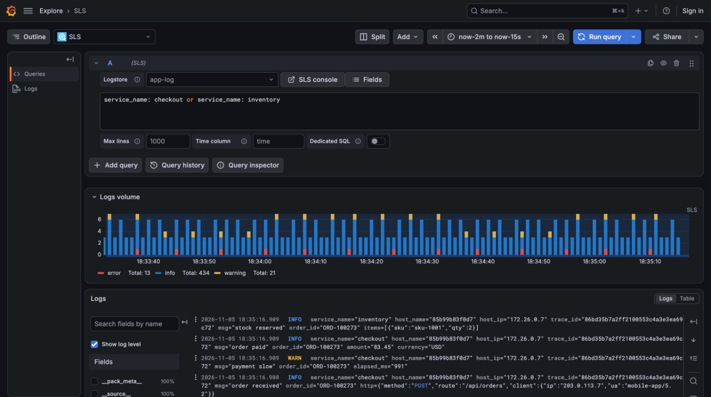
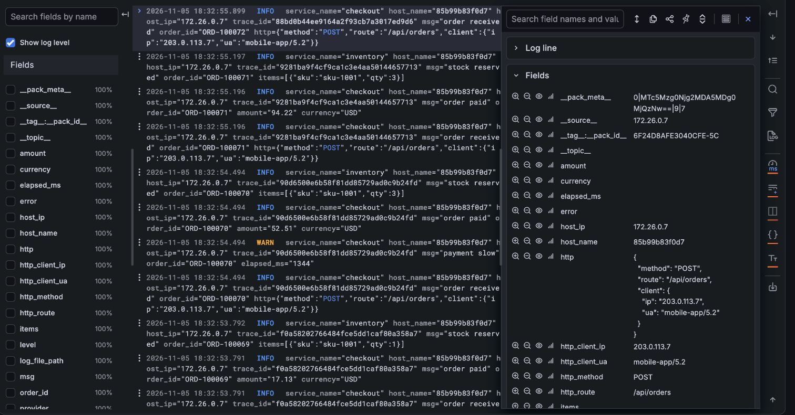
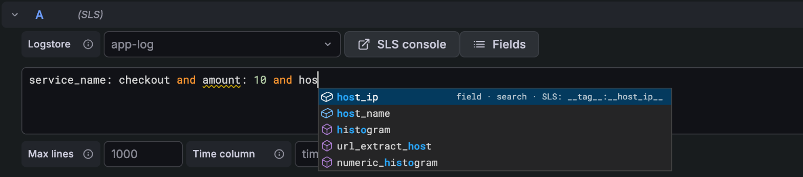
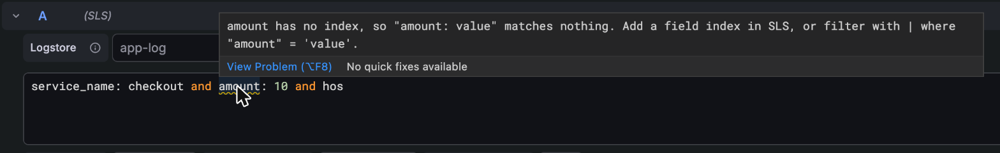
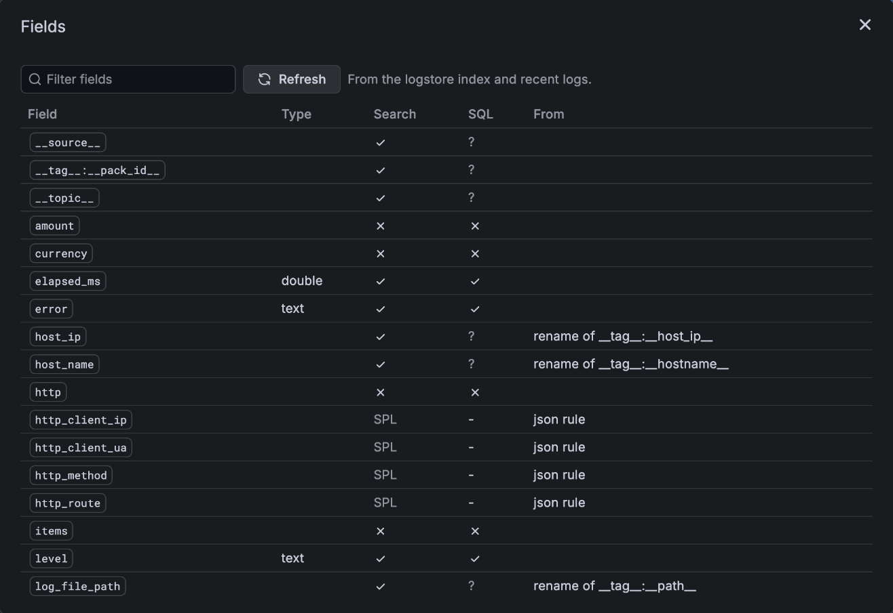
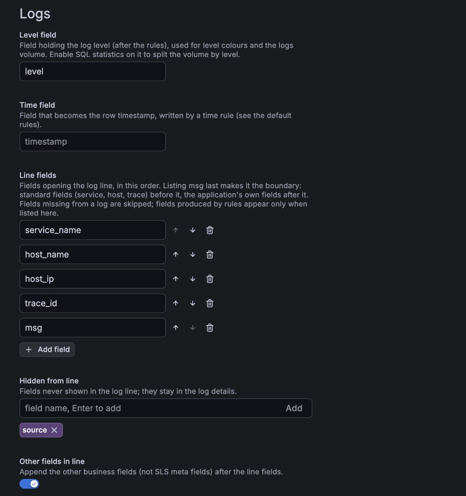
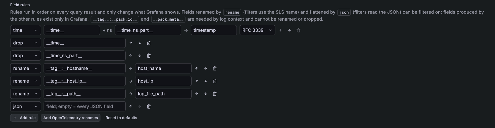

# nethinwei-sls-datasource

阿里云日志服务（SLS）的社区版 Grafana 数据源。

[English](README_EN.md)

在 Grafana 中查询阿里云日志服务（SLS）：检索与 SPL 返回日志，SQL 返回表格或时间序列，可用于看板、Explore 和告警。



> 本项目衍生自阿里云官方插件 [aliyun/aliyun-log-grafana-datasource-plugin](https://github.com/aliyun/aliyun-log-grafana-datasource-plugin) 2.39.2，独立维护：面向 Grafana 13 重写，删除了与 Grafana 生态重复或过时的功能。插件 ID 为 `nethinwei-sls-datasource`，与官方插件（`aliyun-log-service-datasource`）是两个插件，可以同时安装；迁移方法见「从官方插件迁移」。设计与取舍见 [docs/design/grafana-13-adaptation.md](docs/design/grafana-13-adaptation.md)。

## 兼容性

- Grafana **≥ 13.2**
- 插件未签名，需要在 Grafana 配置中允许加载：`GF_PLUGINS_ALLOW_LOADING_UNSIGNED_PLUGINS=nethinwei-sls-datasource`

## 安装

从 [Releases](../../releases) 下载 `nethinwei-sls-datasource-v<版本>.zip`，用同目录的 `.sha256` 校验后解压到 Grafana 的插件目录（默认 `/var/lib/grafana/plugins`），重启 Grafana。

## 配置数据源

| 配置 | 说明 |
|---|---|
| Endpoint | project 所在地域的接入点，例如 `cn-hangzhou.log.aliyuncs.com`；在阿里云内网使用 `-intranet` 接入点 |
| Project | SLS project |
| Default logstore | 查询未指定 logstore 时使用，健康检查也用它 |
| Region | 地域 ID，例如 `cn-hangzhou`。填写后使用 V4 签名 |
| AccessKey | 建议使用只授权了目标 logstore 的 RAM 用户 |
| SQL time zone | SQL 返回的日期时间字符串（`timestamp` 列、`from_unixtime`、`date_format`）的时区，SLS 默认 UTC+8，所以默认 `Asia/Shanghai` |
| Max wide-table cells / Max flattened fields | 单次查询结果的内存上限：SQL 转时间序列的单元格数（默认 600 万，超出时报错并提示减少维度），`json` 规则每次结果最多展开的字段数（默认 200，超出部分保留原 JSON 并提示） |
| Logs | 日志的处理与展示：级别字段、时间字段、日志行字段、字段规则，见下文「日志处理」 |

最小权限：查询只需要 `log:GetLogStoreLogs`。以下权限可选：`log:GetLogStore`（健康检查）、`log:ListLogStores`（logstore 下拉列表）、`log:GetIndex`（字段目录：补全、字段提示、字段浏览与筛选，没有时从样本日志中归纳）、`log:GetLogStoreContextLogs`（日志上下文）、`log:GetLogStoreHistogram`（级别字段未开启统计时的日志量）。

## 查询

查询语句就是 SLS 的语法，结果形式由语句决定：

| 语句 | 结果 |
|---|---|
| 检索：`level: ERROR and service_name: api` | 日志。日志行由字段拼成（`key="value"`，按写入顺序，不含 `__tag__` 等元数据，可配置，见「日志处理」），时间精确到纳秒（采集端开启纳秒时间戳时） |
| SPL：`* \| where cost_ms > 1000` | 日志 |
| SQL：`* \| select service_name, count(*) as c group by service_name` | 表格，列按 SLS 返回的类型输出（数值、布尔、时间） |
| 带时间列的 SQL | 时间序列。时间列默认叫 `time`（可在查询选项里修改）；其余的字符串列作为维度，每个组合一条序列 |

时间序列示例：

```sql
* | select $__timeGroup(__time__) as time, service_name, count(*) as requests
    group by time, service_name order by time desc limit 10000
```

### 宏

| 宏 | 展开为 |
|---|---|
| `$__timeGroup(col)` | `((col) - (col) % <面板间隔秒数>)`；指定间隔：`$__timeGroup(__time__, 5m)`；col 可以是表达式，例如 `$__timeGroup(__time__ + 28800, 24h)` 按东八区自然日分组 |
| `$__interval_s` | 面板间隔，单位秒 |
| `$__timeFrom` / `$__timeTo` | 查询时间范围的起止，unix 秒 |

查询的时间范围总是由 Grafana 的时间选择器决定，不需要在语句里写时间条件。带 LIMIT 的时间序列请用 `order by time desc`：升序截断会丢掉最新的数据（例如告警按秒分桶、时间范围较长时），插件会把结果重新按时间升序排列。

### 变量

- 在检索语句里写 `key: $var`。多值变量会自动展开成 `(key: "a" or key: "b")`；选「All」且全部值为 `*` 时展开为 `key: *`。
- 在 SQL 里使用 Grafana 的格式化写法，例如 `where service_name in (${service_name:sqlstring})`。
- 变量查询：一条 SQL，第一列作为选项，例如 `* | select service_name from log group by service_name limit 500`。

### 查询选项

| 选项 | 说明 |
|---|---|
| Max lines | 检索返回的最多日志条数，默认 1000，最多 5000；SQL 的行数由 LIMIT 决定 |
| Format | SQL 结果的形式：Time series（默认，带时间列时转为时间序列）或 Table（原样输出表格） |
| Time column | Format 为 Time series 时，SQL 结果中的时间列，默认 `time` |
| Dedicated SQL | 使用 SLS SQL 独享版（资源更多，单独计费） |

查询检查器（Query inspector）会显示实际执行的语句和 SLS 的执行统计；结果不完整（Incomplete）时会给出提示。

## 日志浏览

| 功能 | 说明 |
|---|---|
| 日志量直方图 | Explore 中按级别统计整个时间范围的日志量（由 SLS 计算，不只是已返回的行）。级别字段开启了 SQL 统计时按级别拆分，否则只显示总量。只对检索语句生效 |
| 点字段筛选 | Explore 的日志详情中点 ➕ / ➖：有索引的字段在检索语句中加入 `key: "value"` / `not key: "value"`，没有索引的字段和展开的嵌套字段追加 SPL `\| where`；再点一次移除。规则产生的其他字段（`extract`、`template` 等）只存在于 Grafana，不能筛选 |
| 看板筛选 | 看板日志面板中点 ➕ / ➖ 会生成看板的 Filters 变量，作用于该数据源的所有查询（包括 SQL 面板）。筛选由后端按字段目录翻译：改过名的字段用 SLS 原名，有索引的字段用检索条件，没有索引的字段用 SPL `\| where`；`=~` / `!~` 用 `regexp_like`，整个值匹配（不转成检索通配符：模糊查询只采样 100 个词，也不支持数值字段）；数值比较只对 long、double 索引走检索，其余用 `cast(...)`。SQL 语句后面不能接 SPL，这类筛选会跳过并在面板上提示 |
| 日志上下文 | 日志行菜单中的「Show context」：由 SLS 从同一来源读取前后的日志（GetContextLogs），不受当前查询条件限制 |
| 级别 | 「Logs → Level field」（默认 `level`）用于级别着色和日志量 |
| 字段补全与提示 | 查询编辑器按字段目录补全：显示 Grafana 中的字段名、插入 SLS 字段名，并标出能否检索、能否用于 SQL。检索没有索引的字段、在 SLS 语句里写 Grafana 字段名、SQL 用到没有统计的字段时，编辑器会给出提示 |
| 字段浏览 | 查询编辑器的「Fields」按钮列出 logstore 的全部字段：类型、能否检索、能否用于 SQL、来自哪条规则；修改索引后可刷新 |









上下文依赖每行日志的 `__tag__:__pack_id__` 与 `__pack_meta__`：插件会给检索和 SPL 查询自动追加 `| with_pack_meta`。

## 日志处理

数据源配置的「Logs」决定日志怎样显示，只影响 Grafana 中看到的结果，不改动 SLS 中的数据。

| 配置 | 说明 |
|---|---|
| Level field | 级别字段（规则处理之后的名字），默认 `level` |
| Time field | 作为日志时间的字段，由 `time` 规则写入，默认 `timestamp` |
| Line fields | 日志行开头依次显示的字段，可调整顺序，例如 `service_name`、`host_name`。把 `msg` 列在最后可以让它成为分界线：前面是标准字段，后面是应用自己写的字段。日志里没有的字段自动跳过；规则产生的字段只有列在这里才进入日志行 |
| Other fields in line | 是否在后面接着显示其余业务字段（不含 `__` 开头的元数据），按日志写入时的顺序，默认开。级别字段已由 Grafana 单独显示，不重复放进日志行，需要时可列入 Line fields |
| Hidden from line | 不进日志行的字段，仍然显示在日志详情里 |
| Field rules | 按顺序执行的字段规则，见下表 |



日志行的值按 logfmt 写法加引号，值里的 `"` 和 `\` 会转义。嵌套对象（slog 的 Group、记录的结构体或 map；采集端把它存成一段 JSON 文本）和数组原样输出、不加引号，日志详情中会格式化显示。

字段规则：

| 规则 | 示例 | 说明 |
|---|---|---|
| `time` | `__time__` + `__time_ns_part__` → `timestamp` | 由秒和可选的纳秒字段合成时间。目标是时间字段时成为日志时间；采集端没有纳秒字段时纳秒按 0 处理 |
| `rename` | `__tag__:__hostname__` → `host_name` | 改名。筛选与补全会自动换回 SLS 原名 |
| `extract` | `log_file_path` 按 `/logs/(.+)\.log` 取 `$1` → `service_name` | 正则提取，支持命名分组 `${name}` |
| `drop` | `__topic__` | 隐藏字段 |
| `default` | `deployment_environment` = `prod` | 字段缺失或为空时的取值 |
| `template` | `${service}/${env}` → `app` | 由其他字段拼出新字段，`$$` 表示 `$` |
| `json` | `request` → `request_method`、`request_header_Content_Type` | 把嵌套的 JSON 对象展开成字段，规则同 Loki 的 `\| json`：键名用 `_` 连接，字母、数字、`_` 以外的字符换成 `_`，数组和 null 跳过，与已有字段重名时加 `_extracted`。不填 from 时展开所有值为 JSON 对象的字段 |



没有配置规则时使用默认规则：用 `__time__` 和 `__time_ns_part__` 合成 `timestamp`，隐藏这两个字段，再用 `json` 展开所有嵌套对象。配置页的「Add OpenTelemetry renames」会追加 `host_name`、`host_ip`、`log_file_path` 三条改名规则（OpenTelemetry 语义名，点号换成下划线，与 Loki 存储 OpenTelemetry 属性的方式一致；Grafana 的日志高亮只把字母、数字、下划线认作字段名）。`rename` 改名的字段和 `json` 展开的字段可以筛选，其他规则产生的字段只存在于 Grafana，不能用于筛选。`__tag__:__pack_id__` 与 `__pack_meta__` 是日志上下文需要的字段，不能改名或隐藏；无效的规则会被跳过，并在「Save & test」中列出。

用配置文件创建数据源时：

```yaml
jsonData:
  project: my-project
  logstore: app-log
  logs:
    levelField: level
    line:
      fields: [service_name, host_name, host_ip, msg]
      exclude: [source]
    rules:
      - { type: time, from: __time__, nanos: __time_ns_part__, to: timestamp }
      - { type: drop, field: __time__ }
      - { type: drop, field: __time_ns_part__ }
      - { type: json }
      - { type: rename, from: __tag__:__hostname__, to: host_name }
      - { type: rename, from: __tag__:__host_ip__, to: host_ip }
```

### 嵌套字段（JSON）

默认规则中的 `json` 会把嵌套对象展开成字段（见上表），展开的字段可以像普通字段一样筛选：字段在 SLS 中建了 JSON 索引时用检索（`request.method: "POST"`）；没有索引时用 SPL `| where json_extract_scalar("request", '$["method"]') = 'POST'`，效果等同 Loki 的 `| json | request_method="POST"`。否定条件（`!=`、`!~`）对缺少该字段的日志按空值处理，与 Loki 一致；正则匹配整个值。

也可以在采集时就展开嵌套，让它们成为 SLS 中的真实字段（可建索引、可做 SQL 统计）。LoongCollector 的原生 JSON 解析插件不展开嵌套，需要改用扩展插件 `processor_json`；扩展插件之后不能再接原生插件，时间改用 `processor_gotime` 解析：

```yaml
processors:
  - Type: processor_json
    SourceKey: content
    ExpandDepth: 0            # 不限深度
    ExpandConnector: "_"      # 与插件和 Loki 的命名一致：http_client_ip
    IgnoreFirstConnector: true  # 否则所有字段名都以 _ 开头
    KeepSource: false
  - Type: processor_gotime
    SourceKey: time
    SourceFormat: "2006-01-02T15:04:05.999999999Z07:00"
    DestKey: time_parsed
    DestFormat: "2006-01-02T15:04:05.999999999Z07:00"
    SetTime: true             # 保留纳秒
    KeepSource: false
  - Type: processor_drop
    DropKeys: [time_parsed]
```

实测：字段保持写入顺序；数组保留为 JSON 文本，null 存为 `"null"`；键名中的 `-`、`.` 等字符不替换（`request_header_X-Request-Id`），以字符串保存的 JSON 不展开。两种方式可以并存：采集端展开后 `json` 规则不再有事可做；展开字段的筛选同时匹配两种存储（`coalesce("http_method", json_extract_scalar("http", '$["method"]'))`），新旧数据混在一起时也能正确筛选。注意：SLS 执行 SPL `| where` 时，会把条件里用到的字段移到结果的最后，所以这类查询的日志行中这些字段不在原来的位置。

## 从官方插件迁移

本插件（`nethinwei-sls-datasource`）与阿里云官方插件（`aliyun-log-service-datasource` 2.x）是两个插件，可以同时安装，不读取 2.x 的旧写法。迁移步骤：

1. 安装本插件，新建数据源（配置项见上文），或在 provisioning 文件里把数据源的 `type` 改为 `nethinwei-sls-datasource`。
2. 看板 JSON 中把数据源与查询的 `type`（或 `datasource.type`）从 `aliyun-log-service-datasource` 改为 `nethinwei-sls-datasource`，`uid` 指向新数据源。
3. 按下表改写查询。

| 2.x | 本插件 |
|---|---|
| `xcol` 填时间列名 | Time column |
| `xcol` 为 `table` / 空（表格、日志模式） | Format 选 Table；检索与 SPL 语句本来就返回日志 |
| `ycol` 的 `分组列#:#数值列`，`xcol` 的 `bar` / `pie` / `map` / `stat` 图表模式 | Format 选 Time series：带时间列时按字符串列自动拆分序列；图表形式交给 Grafana 面板 |
| `logsPerPage` / `currentPage` / `totalLogs` | Max lines |
| `$1m` 换算成秒、`#time_begin` / `#time_end` | 宏 `$__timeGroup`、`$__interval_s`、`$__timeFrom` / `$__timeTo` |
| 变量描述含 `field_search`、多值展开为 `"name":"value"` | 检索里写 `key: $var`，多值自动展开为 `(key: "a" or key: "b")` |
| logstore 选变量时存为 `__custom__@var` | 直接填 `$var` |
| 变量查询两列时第 1 列作显示名、第 2 列作取值 | 列名用 `text` 和 `value`：`* \| select name as text, id as value ...` |
| 时序库（MetricStore / PromQL） | 用 Grafana 的 Prometheus 数据源连接 SLS 时序库的 Prometheus 兼容接口 |
| SLS Trace（`xcol=trace`） | 不再支持 |
| STS 免登跳转控制台（roleArn） | 「SLS console」按钮，用自己的阿里云账号登录 |

## 开发

需要 Node.js 24 与 Go 1.26。

```bash
npm ci
npm run dev          # 前端，监听变更
npm run test:ci      # 前端测试
go test ./pkg/       # 后端测试
make linux           # 构建 linux 后端到 dist/
```

推送形如 `v0.1.0` 的 tag（去掉 `v` 后与 `package.json` 版本一致）后，Release 工作流会从源码构建并发布安装包。

## 许可与商标

MIT，见 [LICENSE](LICENSE)。本项目衍生自 [aliyun/aliyun-log-grafana-datasource-plugin](https://github.com/aliyun/aliyun-log-grafana-datasource-plugin) 2.39.2（MIT，版权归阿里云及其贡献者），来源与署名见 [NOTICE](NOTICE)。

本项目是社区插件，与阿里云、Grafana Labs 无隶属关系，也未获其认可或赞助。阿里云、Alibaba Cloud、Aliyun、日志服务（SLS）是阿里巴巴集团的商标，Grafana 是 Grafana Labs 的商标，这里仅用于说明本插件对接的产品。
