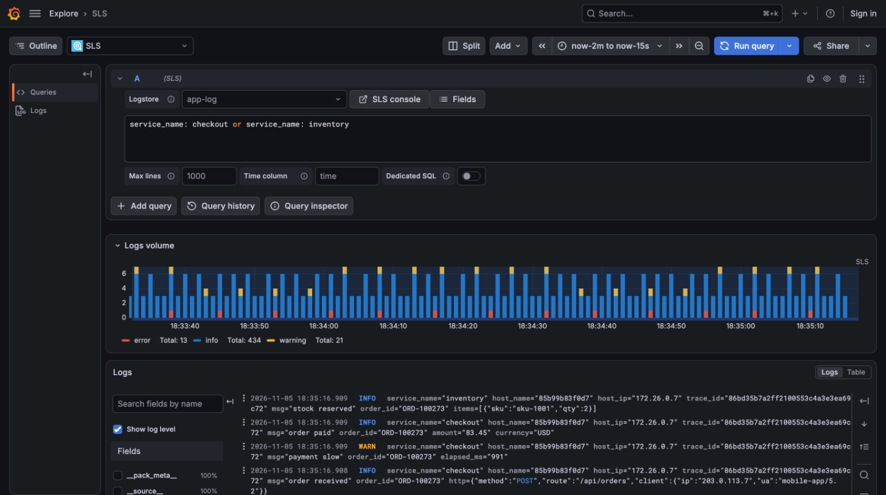
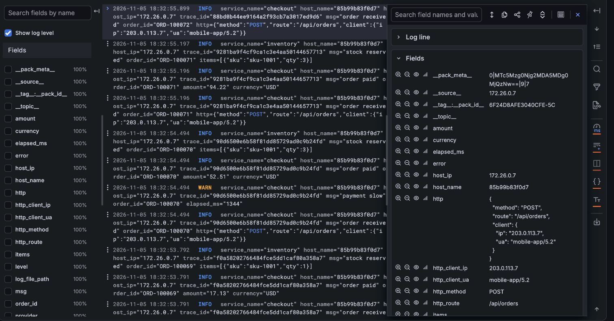
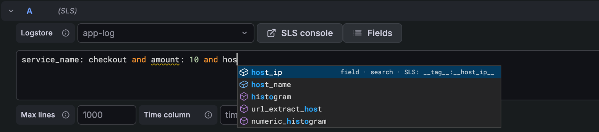
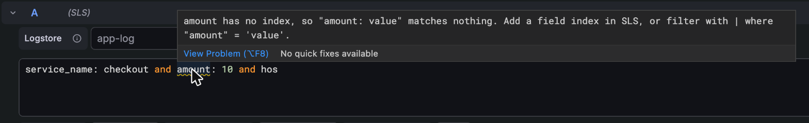
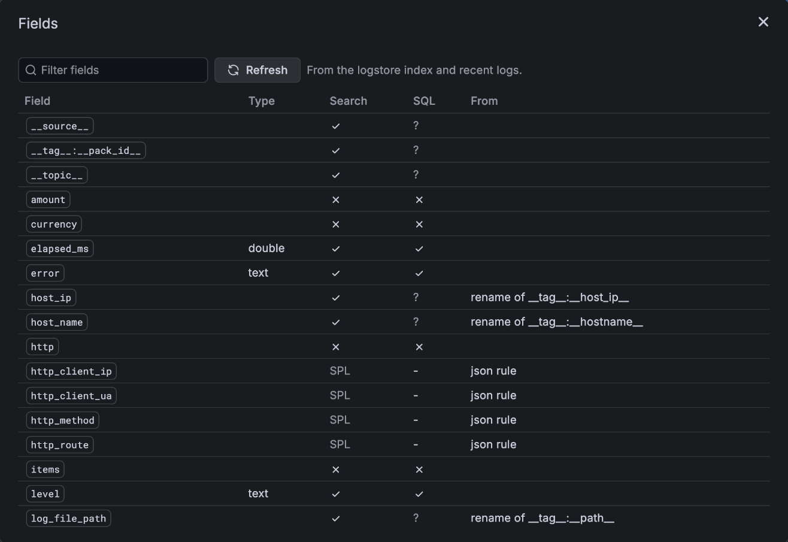
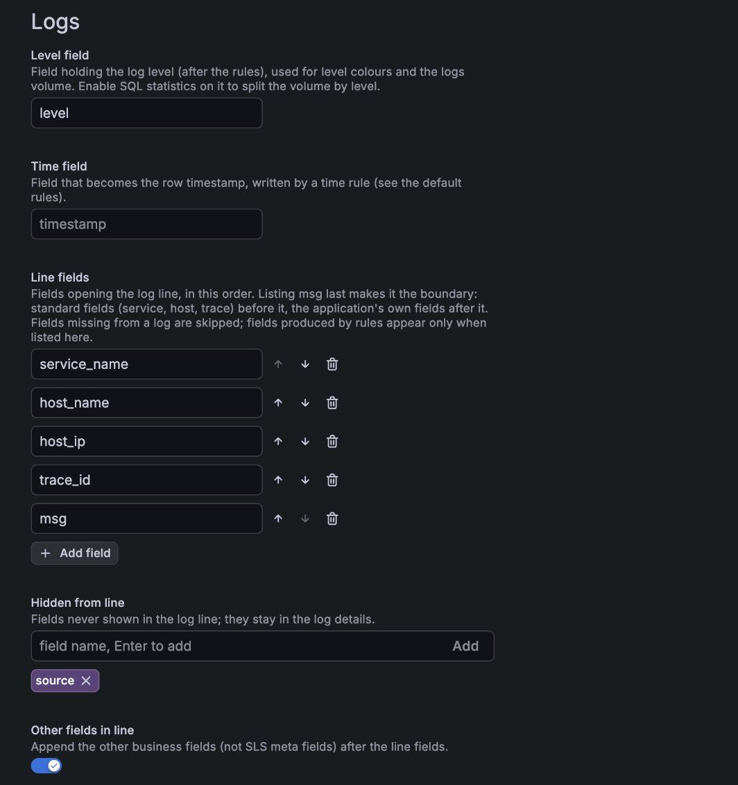
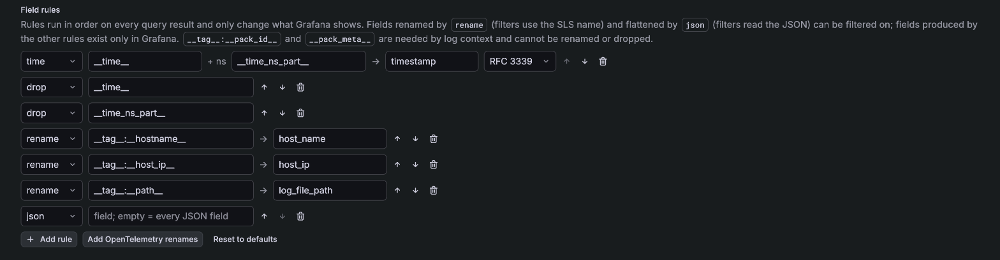

# nethinwei-sls-datasource

A community Grafana data source for Alibaba Cloud Log Service (SLS).

[中文](README.md)

Query Alibaba Cloud Log Service (SLS) from Grafana: search and SPL return logs, SQL returns tables or time series, for dashboards, Explore and alerting.



> This project is derived from Alibaba Cloud's official plugin [aliyun/aliyun-log-grafana-datasource-plugin](https://github.com/aliyun/aliyun-log-grafana-datasource-plugin) 2.39.2 and maintained independently: rewritten for Grafana 13, with features that duplicate the Grafana ecosystem or are outdated removed. Its plugin ID is `nethinwei-sls-datasource`; it is a different plugin from the official one (`aliyun-log-service-datasource`) and both can be installed. See "Migrating from the official plugin". See [docs/design/grafana-13-adaptation.md](docs/design/grafana-13-adaptation.md) for the design (Chinese).

## Compatibility

- Grafana **≥ 13.2**
- The plugin is unsigned; allow it with `GF_PLUGINS_ALLOW_LOADING_UNSIGNED_PLUGINS=nethinwei-sls-datasource`

## Install

Download `nethinwei-sls-datasource-v<version>.zip` from [Releases](../../releases), verify it with the `.sha256` file, unzip it into the Grafana plugin directory (default `/var/lib/grafana/plugins`) and restart Grafana.

## Configure

| Setting | Description |
|---|---|
| Endpoint | Endpoint of the project's region, e.g. `cn-hangzhou.log.aliyuncs.com`; use the `-intranet` endpoint inside Alibaba Cloud |
| Project | SLS project |
| Default logstore | Used when a query does not choose a logstore, and by the health check |
| Region | Region ID such as `cn-hangzhou`; when set, requests use signature V4 |
| AccessKey | Prefer a RAM user granted only on the logstores you query |
| SQL time zone | Zone of date-time strings returned by SQL (timestamp columns, `from_unixtime`, `date_format`). SLS uses UTC+8, hence the default `Asia/Shanghai` |
| Max wide-table cells / Max flattened fields | Memory bounds of one result: cells of an SQL result turned into time series (default 6,000,000; larger results return an error suggesting fewer dimensions), and fields the `json` rule creates per result (default 200; past it the JSON stays as it is, with a notice) |
| Logs | How logs are processed and shown: level field, time field, line fields, field rules; see "Log processing" below |

Least privilege: queries need only `log:GetLogStoreLogs`. Optional: `log:GetLogStore` (health check), `log:ListLogStores` (logstore list), `log:GetIndex` (field catalog: completion, hints, field browser and filters; otherwise inferred from sample logs), `log:GetLogStoreContextLogs` (log context), `log:GetLogStoreHistogram` (volume when the level field has no SQL statistics).

## Query

Queries use SLS syntax; the statement decides the result:

| Statement | Result |
|---|---|
| Search: `level: ERROR and service_name: api` | Logs. The line is built from fields (`key="value"`, in written order, without `__tag__` and other meta fields, configurable, see "Log processing"); nanosecond time when the collector sends it |
| SPL: `* \| where cost_ms > 1000` | Logs |
| SQL: `* \| select service_name, count(*) as c group by service_name` | Table with typed columns (number, boolean, time) |
| SQL with a time column | Time series. The time column is `time` by default (configurable in the query options); other string columns are dimensions, one series per combination |

```sql
* | select $__timeGroup(__time__) as time, service_name, count(*) as requests
    group by time, service_name order by time desc limit 10000
```

### Macros

| Macro | Expands to |
|---|---|
| `$__timeGroup(col)` | `((col) - (col) % <panel interval seconds>)`; fixed interval: `$__timeGroup(__time__, 5m)`; col may be an expression, e.g. `$__timeGroup(__time__ + 28800, 24h)` for days in UTC+8 |
| `$__interval_s` | Panel interval in seconds |
| `$__timeFrom` / `$__timeTo` | Range start / end, unix seconds |

The time range always comes from Grafana's time picker; do not add time conditions to the statement. Time series with a LIMIT should use `order by time desc`: ascending order cuts off the latest data (e.g. alerts bucket by second over long ranges); the plugin sorts the result ascending again.

### Variables

- In search, write `key: $var`. Multi-value variables expand to `(key: "a" or key: "b")`; "All" with the `*` value expands to `key: *`.
- In SQL, use Grafana formats, e.g. `where service_name in (${service_name:sqlstring})`.
- Variable query: SQL whose first column holds the options, e.g. `* | select service_name from log group by service_name limit 500`.

### Query options

| Option | Description |
|---|---|
| Max lines | Max log rows for search, default 1000, at most 5000. SQL rows are limited by LIMIT |
| Format | SQL results as Time series (default; results with the time column become time series) or Table (as they are) |
| Time column | With Format Time series, the time column of SQL results, default `time` |
| Dedicated SQL | Run SQL on the SLS Dedicated SQL engine (more resources, billed separately) |

The Query inspector shows the executed statement and SLS execution statistics; incomplete results are reported as a warning.

## Logs

| Feature | Description |
|---|---|
| Logs volume | Explore shows log counts by level over the whole range, computed by SLS (not only the returned rows). Split by level when the level field has SQL statistics enabled, otherwise the total. Search statements only |
| Filter from fields | ➕ / ➖ in Explore's log details: indexed fields add `key: "value"` / `not key: "value"` to the search, fields without an index and flattened nested fields an SPL `\| where`; clicking again removes it. Other fields produced by rules (`extract`, `template`, ...) exist only in Grafana and cannot be filtered |
| Dashboard filters | ➕ / ➖ in dashboard logs panels create the dashboard Filters variable, applied to every query of this data source (SQL panels included). The backend translates filters with the field catalog: renamed fields use their SLS name, indexed fields become search conditions, fields without an index SPL `\| where`; `=~` / `!~` use `regexp_like` on the whole value (not search wildcards: fuzzy search samples 100 terms and does not work on numbers); number comparisons use search only on long and double indexes, `cast(...)` otherwise. SPL cannot follow SQL, so such filters are skipped with a notice on the panel |
| Log context | "Show context" in the log row menu: SLS reads the lines around the log from the same source (GetContextLogs), regardless of the query filters |
| Level | "Logs → Level field" (default `level`) drives level colours and the volume |
| Completion and hints | The query editor completes fields from the catalog: Grafana name shown, SLS name inserted, with whether the field is searchable and usable in SQL. It warns about search on fields without an index, Grafana-only names in SLS statements, and SQL on fields without statistics |
| Field browser | The "Fields" button lists the logstore's fields: type, searchable, SQL statistics, and the rule behind them; refresh after changing the index |









Log context needs `__tag__:__pack_id__` and `__pack_meta__` on every row: the plugin appends `| with_pack_meta` to search and SPL queries.

## Log processing

"Logs" in the data source settings controls how logs are shown. It only changes what Grafana shows; SLS data is untouched.

| Setting | Description |
|---|---|
| Level field | Level field (name after the rules), default `level` |
| Time field | Field that becomes the log time, written by a `time` rule, default `timestamp` |
| Line fields | Fields opening the log line, in an adjustable order, e.g. `service_name`, `host_name`. Listing `msg` last makes it the boundary: standard fields before it, the application's own fields after it. Fields missing from a log are skipped; fields produced by rules join the line only when listed here |
| Other fields in line | Append the other business fields (not `__` meta fields) in the order they were written, default on. The level field is shown by Grafana as the level and left out of the line unless listed in Line fields |
| Hidden from line | Fields kept out of the line; they stay in the log details |
| Field rules | Rules run in order, see below |



Line values are quoted as in logfmt, with `"` and `\` escaped. Nested objects (slog groups, logged structs or maps; collectors store them as JSON text) and arrays are written as they are, unquoted, and pretty-printed in the log details.

Field rules:

| Rule | Example | Description |
|---|---|---|
| `time` | `__time__` + `__time_ns_part__` → `timestamp` | Time from a seconds field plus an optional nanoseconds field. Targeting the time field makes it the log time; without a nanoseconds field the nanoseconds are 0 |
| `rename` | `__tag__:__hostname__` → `host_name` | Rename. Filters and completion map back to the SLS name |
| `extract` | `log_file_path` with `/logs/(.+)\.log`, `$1` → `service_name` | Regex extraction, named groups as `${name}` |
| `drop` | `__topic__` | Hide a field |
| `default` | `deployment_environment` = `prod` | Value when the field is absent or empty |
| `template` | `${service}/${env}` → `app` | New field from other fields, `$$` is a literal `$` |
| `json` | `request` → `request_method`, `request_header_Content_Type` | Flattens nested JSON objects into fields, as Loki's `\| json`: keys joined with `_`, characters other than letters, digits and `_` become `_`, arrays and nulls skipped, `_extracted` appended on a name clash. Without from, every field holding a JSON object is flattened |



Without configured rules the defaults apply: build `timestamp` from `__time__` and `__time_ns_part__`, hide both, and flatten every nested object with `json`. "Add OpenTelemetry renames" appends renames to `host_name`, `host_ip` and `log_file_path` (OpenTelemetry semantic names with dots as `_`, as Loki stores OpenTelemetry attributes; Grafana's log highlighting only takes letters, digits and `_` as field names). Fields renamed by `rename` and flattened by `json` can be filtered on; fields produced by the other rules exist only in Grafana and cannot. `__tag__:__pack_id__` and `__pack_meta__` are needed by log context and cannot be renamed or dropped; invalid rules are skipped and listed by "Save & test".

Provisioning:

```yaml
jsonData:
  project: my-project
  logstore: app-log
  logs:
    levelField: level
    line:
      fields: [service_name, host_name, host_ip, msg]
      exclude: [source]
    rules:
      - { type: time, from: __time__, nanos: __time_ns_part__, to: timestamp }
      - { type: drop, field: __time__ }
      - { type: drop, field: __time_ns_part__ }
      - { type: json }
      - { type: rename, from: __tag__:__hostname__, to: host_name }
      - { type: rename, from: __tag__:__host_ip__, to: host_ip }
```

### Nested fields (JSON)

The `json` rule of the default rules flattens nested objects into fields (see the table above), and flattened fields filter like any other field: by search when the field has a JSON index in SLS (`request.method: "POST"`), otherwise with SPL `| where json_extract_scalar("request", '$["method"]') = 'POST'`, like Loki's `| json | request_method="POST"`. Negative operators (`!=`, `!~`) treat a missing field as empty, as Loki does; regexes match the whole value.

Nested objects can also be expanded at collection time, so they become real SLS fields (indexable, usable in SQL). LoongCollector's native JSON parser does not expand nesting; use the extended `processor_json`. Native processors cannot follow extended ones, so parse the time with `processor_gotime`:

```yaml
processors:
  - Type: processor_json
    SourceKey: content
    ExpandDepth: 0              # unlimited
    ExpandConnector: "_"        # same naming as the plugin and Loki: http_client_ip
    IgnoreFirstConnector: true  # otherwise every name starts with _
    KeepSource: false
  - Type: processor_gotime
    SourceKey: time
    SourceFormat: "2006-01-02T15:04:05.999999999Z07:00"
    DestKey: time_parsed
    DestFormat: "2006-01-02T15:04:05.999999999Z07:00"
    SetTime: true               # keeps nanoseconds
    KeepSource: false
  - Type: processor_drop
    DropKeys: [time_parsed]
```

Measured: fields keep their written order; arrays stay JSON text and null becomes `"null"`; characters such as `-` and `.` in keys are kept (`request_header_X-Request-Id`); JSON kept as a string is not expanded. Both ways can coexist: once the collector expands, the `json` rule has nothing left to do, and filters on flattened fields read both forms (`coalesce("http_method", json_extract_scalar("http", '$["method"]'))`), so mixed old and new data filter correctly. Note that SLS moves fields used in an SPL `| where` condition to the end of each row, so in such queries those fields leave their written position in the line.

## Migrating from the official plugin

This plugin (`nethinwei-sls-datasource`) and Alibaba Cloud's official plugin (`aliyun-log-service-datasource` 2.x) are separate plugins that can be installed side by side; 2.x query fields are not read. To migrate:

1. Install this plugin and create a data source (settings above), or set the data source `type` to `nethinwei-sls-datasource` in provisioning files.
2. In dashboard JSON, change the data source and query `type` (or `datasource.type`) from `aliyun-log-service-datasource` to `nethinwei-sls-datasource`, with the `uid` of the new data source.
3. Rewrite queries as follows.

| 2.x | This plugin |
|---|---|
| `xcol` naming the time column | Time column |
| `xcol` `table` / empty (table and log modes) | Format Table; search and SPL statements return logs anyway |
| `ycol` `group#:#value`, `xcol` chart modes `bar` / `pie` / `map` / `stat` | Format Time series: with a time column the result is split into series by the string columns; let Grafana panels choose the chart |
| `logsPerPage` / `currentPage` / `totalLogs` | Max lines |
| `$1m` in seconds, `#time_begin` / `#time_end` | Macros `$__timeGroup`, `$__interval_s`, `$__timeFrom` / `$__timeTo` |
| Variables with `field_search` in the description, multi values as `"name":"value"` | `key: $var` in search; multi values expand to `(key: "a" or key: "b")` |
| Logstores from variables stored as `__custom__@var` | `$var` |
| Two-column variable queries (first column text, second value) | Name the columns `text` and `value`: `* \| select name as text, id as value ...` |
| MetricStore (PromQL) | Grafana's Prometheus data source on the Prometheus-compatible API of the SLS MetricStore |
| SLS Trace (`xcol=trace`) | Not supported |
| STS console sign-in (roleArn) | The "SLS console" button, signing in with your own Alibaba Cloud account |

## Development

Requires Node.js 24 and Go 1.26.

```bash
npm ci
npm run dev          # frontend, watch mode
npm run test:ci      # frontend tests
go test ./pkg/       # backend tests
make linux           # build linux backends into dist/
```

Pushing a tag such as `v0.1.0` (its version matching `package.json`) runs the Release workflow, which builds from source and publishes the package.

## License and trademarks

MIT, see [LICENSE](LICENSE). This project is derived from [aliyun/aliyun-log-grafana-datasource-plugin](https://github.com/aliyun/aliyun-log-grafana-datasource-plugin) 2.39.2 (MIT, copyright Alibaba Cloud and its contributors); see [NOTICE](NOTICE) for origin and attribution.

This is a community plugin, not affiliated with, sponsored or endorsed by Alibaba Cloud or Grafana Labs. Alibaba Cloud, Aliyun and Simple Log Service (SLS) are trademarks of Alibaba Group; Grafana is a trademark of Grafana Labs. They are used here only to describe what this plugin works with.
